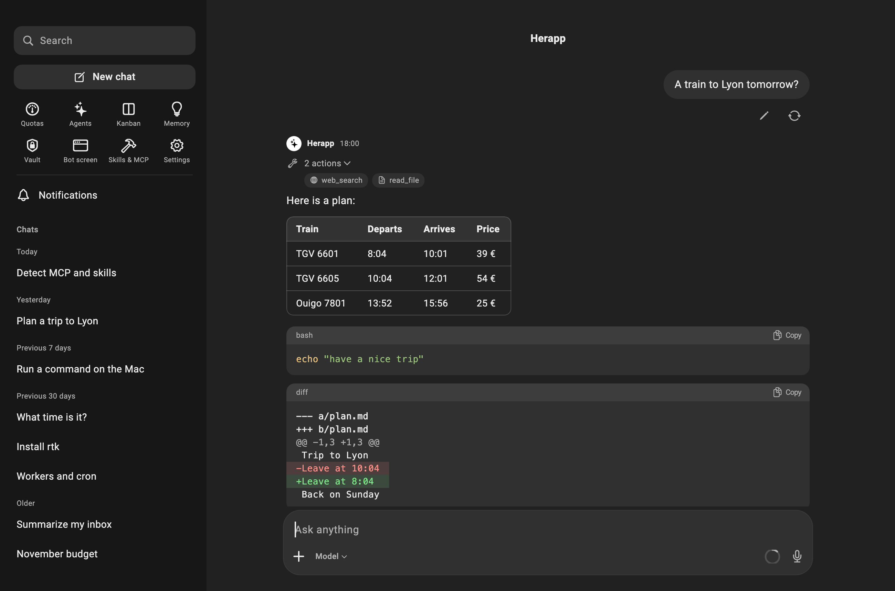
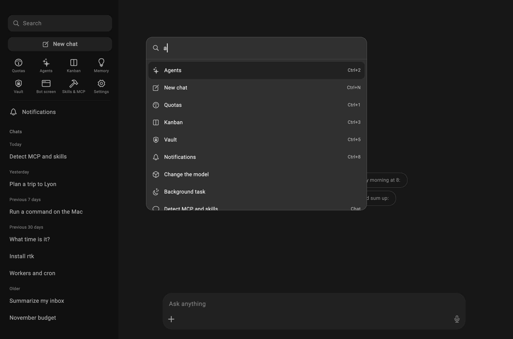
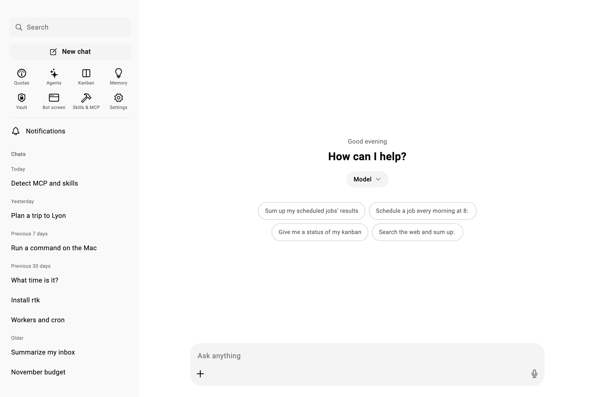
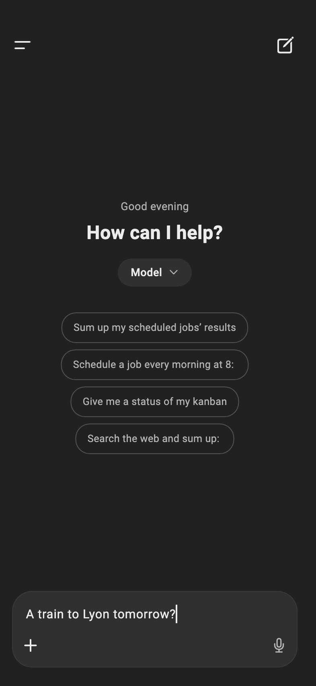

# Herapp

A Flutter client for [Hermes Agent](https://github.com/NousResearch/hermes-agent): streaming
conversations, agents, scheduled jobs, kanban, memory, files, Git on the server and the
remote display, on iOS, Android, macOS and the web.

<p align="center">
  
</p>

<p align="center">
  
  
</p>

<p align="center">
  
</p>

## Features

- Streaming chat with tool calls, Markdown, tables, highlighted code and diffs
- Model picker, side-by-side comparison with another model, background tasks
- Agents, scheduled jobs, kanban, memory, skills & MCP, quotas and a password vault
- Server-side Git, files and the agent's remote display ("Bot screen")
- Voice input and read-aloud
- Command palette and keyboard shortcuts on desktop and the web
- Native extras: built-in WireGuard tunnel, commands and Git on your own Mac, biometric
  lock, share extension, Handoff and push notifications when a scheduled job finishes

Herapp needs a running Hermes dashboard/API. `server/` holds optional helpers (push
notifications and web publishing), not the Hermes backend.

## Run

Use Flutter 3.41.2 (Dart 3.11) or a compatible version. Native builds also need Go,
which compiles the WireGuard tunnel in `native/wg`.

```sh
flutter pub get
flutter run -d chrome --dart-define=HERMES_URL=https://hermes.example.com
```

The server address, Hermes username and password can also be set in Settings. Without
`HERMES_URL`, the browser uses the app's origin as the server address; native apps start
with an empty address. Saved settings override this initial default.

Each [GitHub release](../../releases) has prebuilt apps: an Android APK, an unsigned iOS
`.ipa` to sideload (AltStore, Sideloadly…) and an ad-hoc signed macOS app (macOS 12 or
later). The macOS app isn't notarized: after unzipping, run
`xattr -dr com.apple.quarantine Herapp.app` before opening it.

## Deploy the web app

```sh
flutter build web --release --dart-define=HERMES_URL=https://hermes.example.com
```

Serve `build/web/` over HTTPS. HTTPS is required for the browser's encrypted password
storage and microphone access; localhost also works for development. The JavaScript web
build is supported; the text-to-speech plugin reports compatibility warnings for
WebAssembly builds.

### Same origin as Hermes (recommended)

Hosting Herapp on the same origin as Hermes avoids cross-origin cookie restrictions. For
example, keep Hermes at `https://hermes.example.com/` and serve Herapp under
`https://hermes.example.com/herapp/`:

```sh
flutter build web --release --base-href=/herapp/
```

Serve the files from the web server's `/herapp/` directory and forward the `/api/`,
`/auth/` and dashboard routes to Hermes. The proxy must support WebSocket upgrades for
`/api/ws` and `/api/display/ws`.

Alternatively, `server/publish-web.py` installs a build into the Hermes dashboard's own
static directory, so no extra web server is needed:

```sh
python3 server/publish-web.py <build directory named after the release> <hermes web_dist directory>
```

It copies the release into `.herapp-releases/` and atomically switches the `herapp`
symlink, keeping earlier releases for rollback. Herapp is then at
`https://<hermes>/herapp/index.html` and reuses the Hermes login session. If a Hermes
update replaces `web_dist`, publish the build again.

### Separate origin

Configure Hermes or its reverse proxy to:

- Allow the exact Herapp origin with CORS, including preflight requests, the HTTP methods
  in use, `Content-Type` and `X-Hermes-Session-Token`.
- Send `Access-Control-Allow-Credentials: true`; a wildcard origin is incompatible with
  credentialed requests.
- Issue cookies suitable for that deployment. Cross-site cookies require
  `SameSite=None; Secure` and may still be blocked by browser privacy settings.
- Accept the Herapp origin for the chat and display WebSockets, using HTTPS/WSS
  throughout when the app is served over HTTPS.

Cookies, including HttpOnly sessions, are managed by the browser. After signing in, the
app obtains one-use WebSocket tickets from Hermes. Loopback dashboard token
authentication is also supported.

## Platform differences

The web client supports the remote Hermes features, file attachments, image downloads
and the remote display. Speech input/output depends on browser support and permissions.
Preferences and encrypted credentials belong to the browser origin.

The WireGuard tunnel, commands and Git on the user's computer, biometric lock, Apple
integrations and background push notifications are native-only, and their settings are
hidden in the browser. Use a system VPN if Hermes is on a private network.

## Push notifications

`server/herapp-push.py` runs next to Hermes as a user service (`herapp-push.service`) and
sends a Firebase Cloud Messaging notification when a scheduled job finishes. The Firebase
configuration in this repository belongs to the original project: for your own build,
create a Firebase project, run `flutterfire configure` and give the service a service
account key in `~/.config/herapp-push/service-account.json`. See the script's docstring
for its options.

## Checks

```sh
flutter analyze
flutter test
flutter build web --release
```

Browser integration tests use a loopback Hermes fixture. In one terminal:

```sh
dart run tool/web_test_server.dart
```

In another:

```sh
flutter test --platform chrome test/web_test.dart
```

They exercise real browser cookies and CORS, expired-session recovery, gateway tickets,
streamed events, binary display frames and the chat/settings UI. CI runs these checks and
uploads the compiled web build as an artifact.

## License

[MIT](LICENSE)
